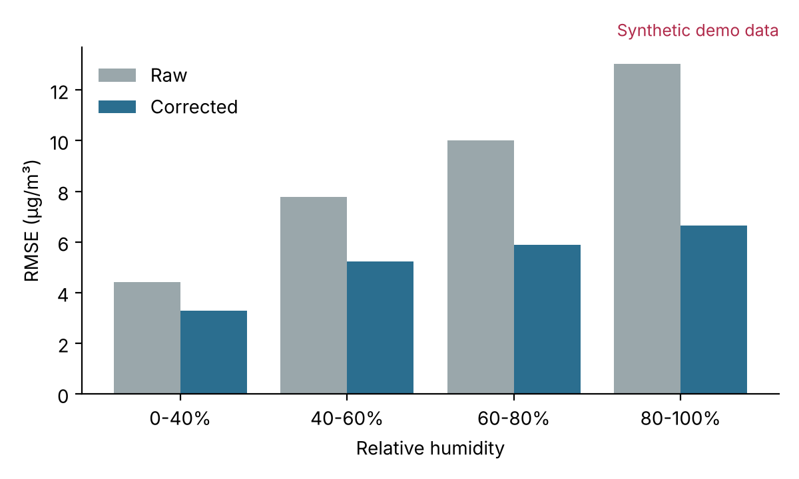

ID: b-res1
Type: Paragraph
Status:
Synopsis: The corrected sensors track the reference monitors closely,
except during wildfire smoke events.

Claude adjust: Draft this once the calibration run finishes.

---

=== Notes ===
